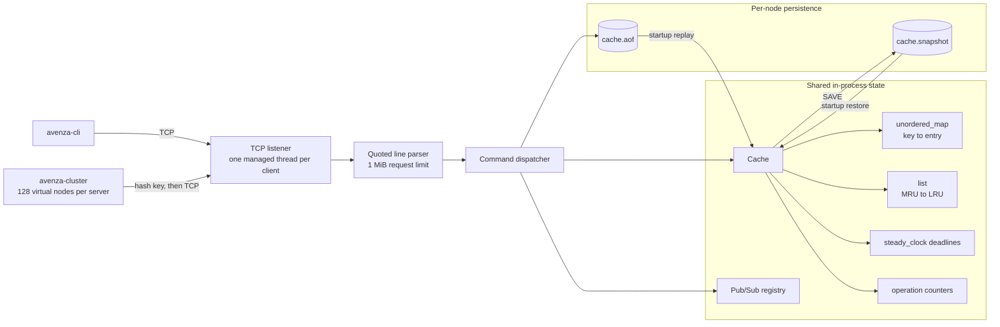
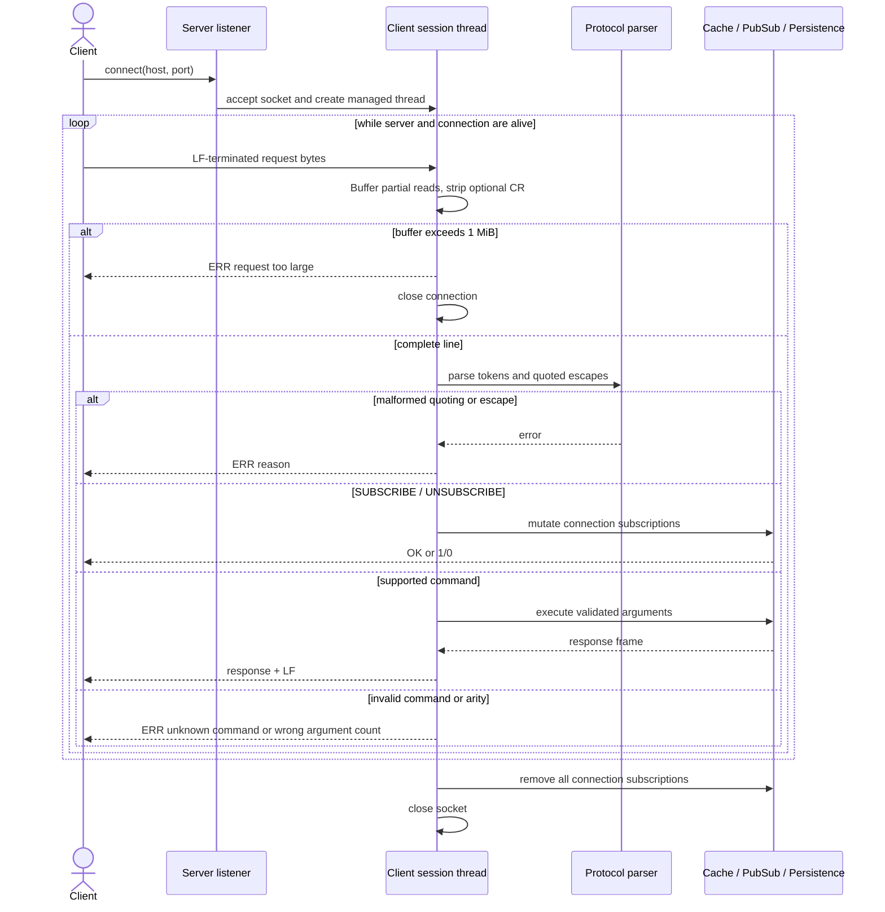
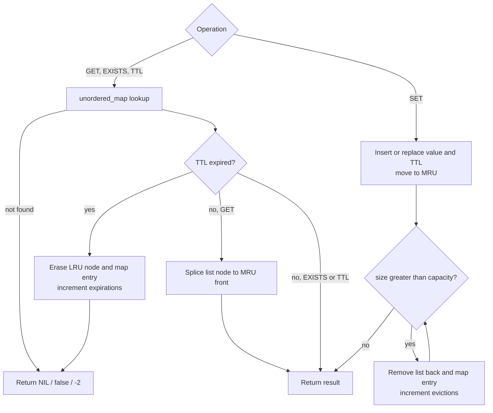
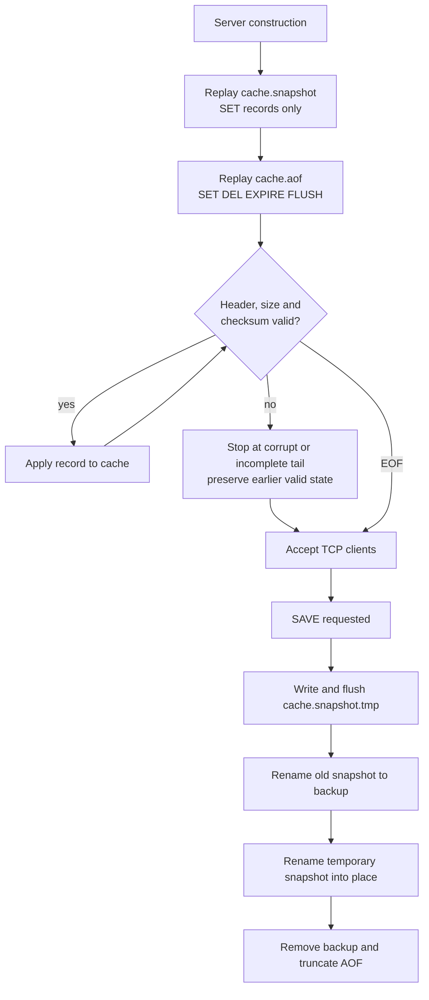
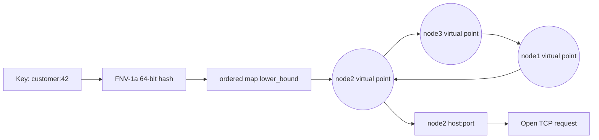
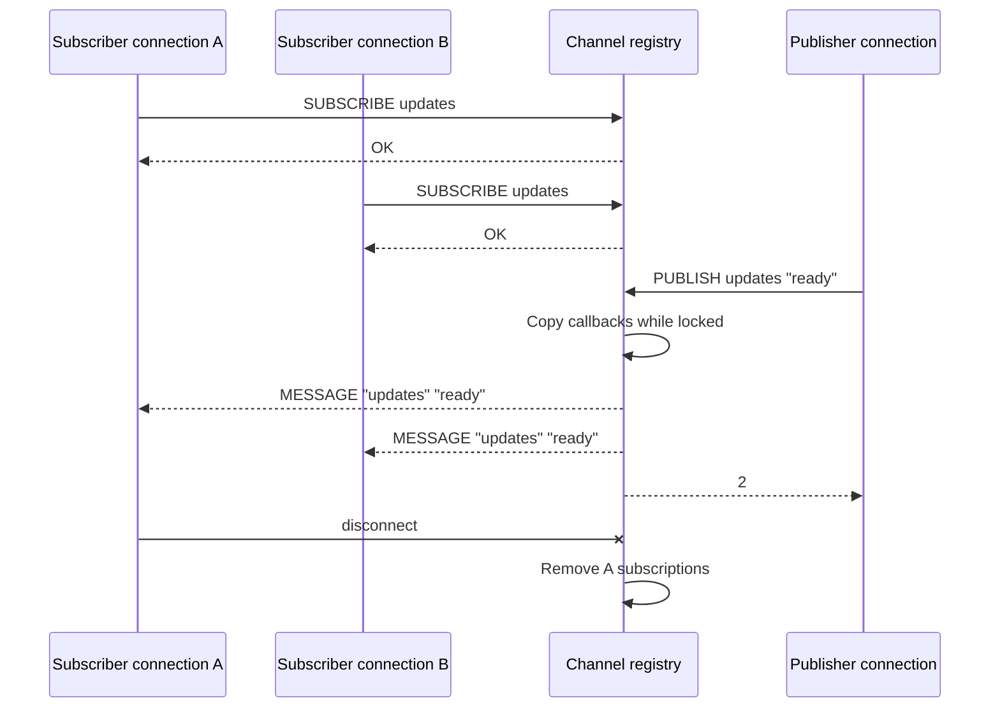

# Distributed In-Memory Data Engine

### A concurrent C++20 key-value engine combining TCP-based request handling, memory-efficient caching, persistence and distributed key partitioning.

[](https://isocpp.org/)
[](https://cmake.org/)
[](https://learn.microsoft.com/windows/win32/winsock/)
[](https://pubs.opengroup.org/onlinepubs/9699919799/)
[](.github/workflows)
[](LICENSE)

Distributed In-Memory Data Engine is a bounded, concurrent key-value server built directly on the C++ Standard Library and native sockets. It combines expected constant-time cache access with LRU eviction, per-key TTLs, checksummed persistence, transient Pub/Sub, and consistent-hash partition selection.

The project is a systems-engineering implementation rather than a cache tutorial. It addresses the invariants that appear when a hash table becomes a networked stateful service: framing byte streams, coordinating shared data structures, tracking recency without scans, expiring data correctly across restarts, recovering a valid log prefix, and assigning keys predictably across static nodes.

> [!NOTE]
> The repository implements multiple independently runnable servers and a client-side partition router. It does **not** implement replication, automatic failover, membership discovery, or data migration. It is not presented as production-ready.

**Technical index:** [Execution model](#execution-model) · [Request path](#tcp-request-path) · [Memory](#memory-and-concurrency) · [Persistence](#persistence-and-recovery) · [Partitioning](#consistent-hash-partitioning) · [Protocol](#wire-command-reference) · [Build](#build-and-run) · [Evidence](#verification-and-performance-evidence)

---

## Execution model



The library target retains its internal `cacheforge` namespace and the executables retain their `avenza-*` names to preserve source and command compatibility. The public repository identity is Distributed In-Memory Data Engine.

### Module boundaries

| Module | Responsibility |
|---|---|
| `cache.hpp/.cpp` | Key/value ownership, LRU list, TTL state, counters, Pub/Sub registry |
| `protocol.hpp/.cpp` | Whitespace tokenization, quoted values, escape parsing and response quoting |
| `network.hpp/.cpp` | Winsock/POSIX lifecycle, listener, client sessions, command dispatch, TCP client |
| `persistence.hpp/.cpp` | Binary AOF records, checksums, snapshot replacement and startup replay |
| `distributed.hpp` / `consistent_hash.cpp` | FNV-1a hash ring, virtual nodes, membership and key lookup |
| `client/` | Direct interactive client and static consistent-hash router |
| `benchmarks/` | Deterministic single-thread, in-process cache benchmark |

## TCP request path



TCP reads are accumulated because one `recv` is not assumed to equal one command. Responses and asynchronous `MESSAGE` frames share the same connection and are serialized by a per-client write mutex. Disconnection removes the session’s subscriptions. Server shutdown marks connections dead, shuts down sockets, and joins managed client threads.

## Memory and concurrency

Each entry owns its value, an optional monotonic deadline, and an iterator into a doubly linked `std::list` of keys. The list front is most recently used; the back is the eviction candidate. An `std::unordered_map` provides key lookup.

One cache mutex protects the map, list, TTL metadata, and statistics together. This coarse-grained design makes cross-structure invariants straightforward: a list iterator is never updated independently from its map entry. `GET` takes the exclusive lock because it moves the list node and increments counters. The design is thread-safe but neither lock-free nor read-parallel.

The server uses one thread per accepted client. Listener state is atomic; connection and thread collections have separate mutexes. Pub/Sub uses its own mutex and copies callbacks before invoking them, so publisher callbacks do not execute while the registry lock is held.

## Eviction and expiration



`SET` updates recency and evicts from the list back until capacity is satisfied. Cache capacity counts entries, not bytes. In-process TTL uses `steady_clock`; it is not affected by wall-clock adjustment. Expiration is lazy during access and during full scans used by `size()`, `records()`, and snapshots—there is no background expiry thread.

`EXPIRE` with a non-positive value deletes an existing key. `TTL` returns `-1` for a permanent key and `-2` for a missing or expired key. Persistence converts monotonic remaining lifetime into an absolute Unix-millisecond deadline so time spent offline is respected during recovery.

## Persistence and recovery

Every node owns `cache.aof` and `cache.snapshot` in its configured data directory. Records contain a magic number, operation type, key/value lengths, expiry, and a 64-bit FNV-1a checksum.



Successful `SET`, `DEL`, `EXPIRE`, and `FLUSHALL` mutations append AOF records; reads and Pub/Sub do not. Startup restores the snapshot first and then applies the AOF. Expired records are skipped. Oversized, checksum-invalid, unknown, or incomplete trailing records stop replay without discarding the valid prefix.

`SAVE` writes a temporary snapshot, rotates the previous snapshot through a backup, installs the new file, and truncates AOF. The implementation flushes C++ streams but does not invoke OS `fsync` or directory synchronization, so it does not claim durability across every power-loss/filesystem scenario.

## Consistent-hash partitioning

The cluster client builds a deterministic ordered ring. For each configured node, it hashes `node-id#virtual-index` 128 times using 64-bit FNV-1a. A key is assigned clockwise to the first point at or after the key hash, wrapping to the first point at the end.



Virtual nodes reduce skew and allow only part of the keyspace to change ownership when membership changes. `NODES`, `RING`, and `MAP key` expose the local routing model. The router detects connection failure when it contacts the selected owner and reports it explicitly. It does not reroute, because no replica can provide authoritative data. Membership changes also do not migrate already stored keys.

## Pub/Sub message path



Subscriptions are in-memory and connection-scoped. Publishing returns the number of callbacks selected for that channel. Messages are pushed synchronously to current subscribers only; they are not persisted, acknowledged, replayed, or delivered to disconnected clients.

## Wire command reference

Requests are LF-terminated byte lines; CRLF is accepted. Tokens are whitespace-separated. Double quotes support spaces and `\\`, `\"`, `\n`, `\r`, and `\t` escapes.

| Command | Parameters | Response | Error conditions |
|---|---|---|---|
| `PING` | none | `PONG` | Wrong arity |
| `SET key value` | non-empty key; quoted value allowed | `OK` | Empty key, wrong arity |
| `SET key value EX seconds` | positive integer seconds | `OK` | Non-positive/invalid TTL, token other than `EX` |
| `GET key` | key | `VALUE "..."` or `NIL` | Wrong arity |
| `DEL key` | key | `1` deleted, `0` absent | Wrong arity |
| `EXISTS key` | key | `1` or `0` | Wrong arity |
| `EXPIRE key seconds` | signed integer seconds | `1` changed/deleted, `0` absent | Invalid integer |
| `TTL key` | key | seconds, `-1` permanent, `-2` absent | Wrong arity |
| `FLUSHALL` | none | `OK` | Wrong arity |
| `STATS` / `INFO` | none | space-separated counters | Wrong arity |
| `SAVE` | none | `OK` or `ERR reason` | Persistence disabled or snapshot failure |
| `SUBSCRIBE channel` | connection-local channel | `OK` | Wrong arity |
| `UNSUBSCRIBE channel` | channel | `1` removed, `0` not subscribed | Wrong arity |
| `PUBLISH channel message` | quoted message allowed | subscriber count | Wrong arity |

Cluster-client-only commands are `NODES`, `RING`, and `MAP key`. They inspect the client-side ring and are not sent to a server.

## Complexity profile

Let `n` be live cache entries, `v` virtual points per node, `N` ring points, `s` subscribers in one channel, and `R` persistence records.

| Operation | Expected / dominant cost | Worst case or qualification |
|---|---|---|
| `GET` | Expected `O(1)` map lookup and list splice | `O(n)` hash collision worst case; exclusive mutex |
| `SET` / update | Expected `O(1)` plus one `O(1)` eviction when one entry over capacity | Hash-table rehash can be `O(n)` |
| `DEL`, `EXISTS`, `EXPIRE`, `TTL` | Expected `O(1)` | Hash collision worst case `O(n)` |
| LRU touch / eviction | `O(1)` list splice or back erase plus expected map erase | Map worst case applies |
| Full expiration purge | `O(n)` | Invoked by size/record scans, not every access |
| Snapshot creation | `O(n)` data traversal plus bytes written | Holds cache mutex while records are copied |
| Startup recovery | `O(R + bytes)` expected cache mutations | Stops at first invalid tail record |
| Ring lookup | `O(log N)` ordered-map `lower_bound` | Wrap is constant time |
| Add node | `O(v log N)` insertion, after removal scan | Existing `remove` scans ring: `O(N)` |
| Remove node | `O(N)` | Iterates all virtual points |
| Subscribe / unsubscribe | Expected `O(1)` per channel | Hash worst case applies |
| Publish | `O(s)` callback copy and delivery | Slow subscriber socket writes affect publisher thread |
| Disconnect cleanup | `O(c)` for channels held by that client | One unregister per subscribed channel |

## Build and run

### Windows 11

Required: CMake 3.20+, Visual Studio 2022 Build Tools with **Desktop development with C++**, and a Windows 10/11 SDK. From an **x64 Native Tools Command Prompt for VS 2022**:

```powershell
cmake -S . -B build -G "Visual Studio 17 2022" -A x64 -DAVENZA_FETCH_GTEST=ON
cmake --build build --config Release --parallel 2
ctest --test-dir build -C Release --output-on-failure
```

For an offline build, use `-DAVENZA_FETCH_GTEST=OFF`; the dependency-free `avenza-self-test` remains enabled. Clang/Ninja is supported only after the MSVC runtime and Windows SDK environment is initialized:

```powershell
cmake -S . -B build-clang -G Ninja `
  -DCMAKE_CXX_COMPILER="C:/Program Files/LLVM/bin/clang++.exe" `
  -DCMAKE_BUILD_TYPE=Release -DAVENZA_FETCH_GTEST=OFF
cmake --build build-clang --parallel 2
ctest --test-dir build-clang --output-on-failure
```

### Linux

```bash
sudo apt update
sudo apt install -y build-essential cmake git
cmake -S . -B build -DCMAKE_BUILD_TYPE=Release -DAVENZA_FETCH_GTEST=ON
cmake --build build --parallel 2
ctest --test-dir build --output-on-failure
```

### Start a server and client

Multi-configuration Windows build:

```powershell
.\build\Release\avenza-server.exe --port 7001 --capacity 3 --data-dir .\data\node1
.\build\Release\avenza-cli.exe --host 127.0.0.1 --port 7001
```

Ninja/Linux builds place executables directly in `build/`.

```text
> SET profile "Shivansh Kumar"
OK
> GET profile
VALUE "Shivansh Kumar"
> SET session active EX 3
OK
> TTL session
3
> DEL profile
1
```

Server options: `--port N`, `--capacity N`, `--data-dir PATH`, and `--no-persistence`. See [DEMO.md](DEMO.md) for LRU, recovery, Pub/Sub, and routing demonstrations.

### Three static nodes

```powershell
.\scripts\start-cluster.ps1
.\build\Release\avenza-cluster.exe 127.0.0.1:7001 127.0.0.1:7002 127.0.0.1:7003
```

```text
cluster> NODES
cluster> MAP account:42
cluster> SET account:42 "active"
cluster> GET account:42
```

## Verification and performance evidence

The dependency-free integration suite covers cache operations, LRU order, TTL, eight-thread access, parsing, snapshot/AOF recovery, Pub/Sub channel isolation, ring redistribution/restoration, a live TCP server, and two TCP clients. GoogleTest adds focused cache, eviction, expiration, invalid-key, and ring tests.

The previous documented build passed **6 CTest entries**: five discovered GoogleTests plus the integration self-test. On 2026-11-02, a fresh offline MSVC 19.44 / Windows SDK 10.0.26100 Release build compiled every target and the dependency-free integration CTest passed; GoogleTest was not fetched for that run. Docker Compose configuration validation also passed. Docker image/runtime execution remains unverified.

### Recorded in-process benchmark

The existing verified Release run used Clang 23.1.4, 100,000 operations, capacity 10,000, seed 42, and reported 12 hardware threads:

| Workload | Throughput | Average | P50 | P95 | P99 |
|---|---:|---:|---:|---:|---:|
| SET | 2,141,749 ops/s | 0.417 µs | 0.3 µs | 0.9 µs | 1.3 µs |
| GET | 4,570,968 ops/s | 0.185 µs | 0.2 µs | 0.4 µs | 0.5 µs |
| 80% GET / 20% SET | 2,719,623 ops/s | 0.318 µs | 0.2 µs | 0.7 µs | 1.2 µs |

These numbers measure one thread calling the in-process cache API. They exclude TCP, persistence, Pub/Sub, synchronization scaling across workers, and distributed routing, and are machine-specific rather than guarantees.

Run a new measurement with:

```powershell
.\build\Release\avenza-benchmark.exe 100000 10000
```

Record OS, CPU, RAM, compiler, build type, capacity and operation count with any published result. See [docs/PERFORMANCE.md](docs/PERFORMANCE.md).

## Engineering decisions

- `unordered_map` plus `list` makes normal key lookup and recency changes expected `O(1)` without duplicating values.
- A single cache mutex favors correctness and explainability over parallel reads.
- Monotonic deadlines avoid wall-clock jumps during process life; absolute persisted deadlines preserve offline elapsed time.
- A binary checksummed AOF is compact and detects damaged tails, but is not human-readable and lacks strict `fsync` durability.
- Snapshots bound replay work while requiring an `O(n)` copy/write operation.
- Client-side consistent hashing keeps servers independent and deterministic, but static membership does not move stored data.
- Virtual nodes improve placement balance at the cost of more ring points.
- Connection-local Pub/Sub is simple and fast for transient delivery but provides no history or acknowledgement.
- The line protocol is inspectable by humans, while escaping and 1 MiB limits add framing rules absent from a trivial whitespace parser.

## Boundaries and future work

Current limitations:

- No replication, consensus, automatic failover, membership discovery, or key migration.
- No TLS, authentication, authorization, transactions, pipelining, or RESP compatibility.
- Entry-count capacity does not enforce a byte-level memory budget.
- One thread per client and one cache mutex constrain high-concurrency scalability.
- Expiration is lazy; expired data can occupy capacity until accessed or scanned.
- AOF uses stream flush without an explicit OS `fsync` policy.
- Pub/Sub is best-effort, synchronous, transient, and non-durable.
- Network timeouts, backpressure limits beyond frame size, and slow-subscriber isolation are minimal.
- Benchmark evidence does not cover network or multi-threaded throughput.

Future engineering directions—not current features:

1. Add replicated ownership, health-aware membership, and defined consistency semantics.
2. Implement controlled migration during ring changes with epochs and dual-read/write stages.
3. Add configurable AOF synchronization, background snapshotting, and compaction.
4. Replace per-client threads with an event loop or bounded worker architecture.
5. Introduce byte-aware accounting, allocator metrics, and active TTL sampling.
6. Add TLS, authentication, authorization, quotas, and protocol version negotiation.
7. Export structured metrics, logs, tracing, replication lag, and persistence health.
8. Create pipelined network and concurrent workload benchmarks with reproducible reports.

## Repository guide

```text
distributed-in-memory-data-engine/
├── include/cacheforge/       Public engine, networking, persistence and ring APIs
├── src/                      Cache, protocol, persistence, networking and hashing
├── client/                   Direct CLI and consistent-hash router
├── benchmarks/               In-process workload executable
├── tests/                    GoogleTest and dependency-free integration coverage
├── docs/                     Protocol, persistence, architecture and design notes
├── scripts/                  Windows/Linux build and cluster helpers
├── config/                   Static cluster example
├── Dockerfile                Multi-stage Linux image
├── docker-compose.yml        Three independent local nodes
└── CMakeLists.txt            C++20 build graph and optional GoogleTest discovery
```

Documentation: [Protocol](docs/PROTOCOL.md) · [Persistence](docs/PERSISTENCE.md) · [Distributed layer](docs/DISTRIBUTED_SYSTEMS.md) · [Architecture](docs/ARCHITECTURE.md) · [Design decisions](docs/DESIGN_DECISIONS.md) · [Performance](docs/PERFORMANCE.md) · [Interview guide](INTERVIEW_GUIDE.md)

## Developer

### Shivansh Kumar

**Software Engineer | C++ | Systems Engineering | Distributed Systems**

- Portfolio: [shivanshonline.in](https://shivanshonline.in)
- GitHub: [github.com/shivansh07adi-cloud](https://github.com/shivansh07adi-cloud)

Licensed under the [MIT License](LICENSE).
